<sup>**RIEMANN 1859 · ALPÖGE WITH CLAUDE 2026**</sup>

# The Riemann Hypothesis *in pictures*

Twelve figures you can play with: what the conjecture says, why primes and complex zeros are two views of one object, and how the proof announced on 20 November 2026 is reported to work.

<table>
  <tr>
    <td width="50%"><a href="https://den-run-ai.github.io/riemann/video/riemann-hypothesis-explained.mp4">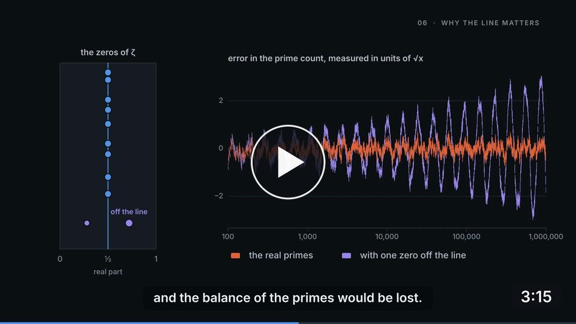</a></td>
    <td width="50%"><a href="https://den-run-ai.github.io/riemann/video/riemann-hypothesis-extended.mp4">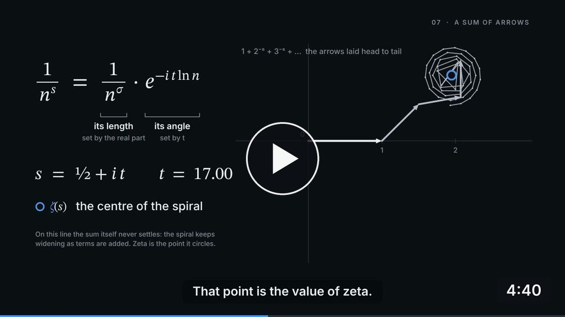</a></td>
  </tr>
  <tr>
    <td valign="top"><b><a href="https://den-run-ai.github.io/riemann/video/riemann-hypothesis-explained.mp4">Watch the short cut, 3 min 15 s.</a></b> The same story, narrated. Ten scenes of intuition, with no formula beyond the definition of zeta.</td>
    <td valign="top"><b><a href="https://den-run-ai.github.io/riemann/video/riemann-hypothesis-extended.mp4">Watch the extended cut, 4 min 40 s.</a></b> Fourteen scenes. Adds Euler's sum 1 + ¼ + ⅑ + ⋯ = π²/6, Euler's product over the primes, complex numbers as rotations, <i>e</i><sup><i>iπ</i></sup> = −1, zeta as a sum of turning arrows, and the key formulas on screen.</td>
  </tr>
</table>

**Also here:** the [interactive version](https://den-run-ai.github.io/riemann/) of this post, with both videos and twelve live figures · [more about the videos](#the-videos) · [how it was all made](docs/SESSION.md)

Each figure below is a recording of the live figure with its controls being moved. To move them yourself, open the [interactive version](https://den-run-ai.github.io/riemann/). It also works offline: download [`index.html`](index.html) and open it in a browser; the figures need no other file.

<p align="center">
  <picture>
    <source media="(prefers-color-scheme: dark)" srcset="media/figure-00-zeta-trace-dark.gif">
    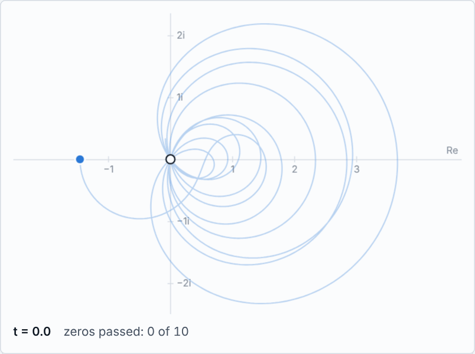
  </picture>
</p>

The path of $\zeta(\tfrac12 + it)$ in the complex plane as $t$ runs from 0 to 50. Each pass through the marked centre point is a zero of $\zeta$. The hypothesis says that zeros of this kind occur on this line and nowhere else.

### Where things stand on 22 November 2026

- **Checked by machine.** On 20 November Levent Alpöge, a mathematician at Anthropic, posted a four-page note saying he believes that, working with Claude, he has proved the Riemann hypothesis and its generalisation to Dirichlet $L$-functions. The proof is a Lean library of about 17 million lines in 175,187 files. On 21 November a joint statement from the Lean and Mathlib communities, endorsed by the Lean FRO and the Mathlib Initiative, certified both the statement and the proof: the main theorem is Mathlib's own definition `RiemannHypothesis`, several independent proof checkers accept it, and it rests only on Lean's three standard axioms.
- **Not yet readable.** There is no paper. The informal write-up is said to run past 250,000 pages and has not been released. Alpöge says he intends to simplify and explain the argument, and that some of the automorphic machinery Claude brought in lies outside his own expertise. Number theorists have only begun to read the code.
- **Open questions.** People auditing the code have found internal definitions that carry less content than their names suggest, and an unreviewed paper argues from this that the proof is invalid. A participant in one verification project who logged the same pattern says it does not make the kernel-checked theorem invalid; it bears on what the intermediate statements mean. A separate 940-page human-written proof of GRH by Alessandro Masullo was released the same day; gaps were reported within hours and it is under revision.

> [!NOTE]
> Sections 1 to 9 are established mathematics. Sections 10 and 11 describe the announced proof from the outside, using the note and a reading guide by early readers of the code. Treat them as a first map.

### Contents

**I · The problem**

1. [Primes thin out smoothly, and jitter](#s1)
2. [Euler's product](#s2)
3. [ζ on the complex plane](#s3)
4. [Zeros are the frequencies of the primes](#s4)
5. [Why ½: the square-root law](#s5)
6. [The zeros look like a spectrum](#s6)

**II · A world where it is a theorem**

7. [Curves over finite fields](#s7)
8. [Stepanov's trick](#s8)
9. [The missing ingredient over the integers](#s9)

**III · The announced proof**

10. [Multiplicity from a chain of theta lifts](#s10)
11. [What a machine check settles](#s11)
12. [If it stands](#s12)

## Part I · The problem

### <a id="s1"></a>1. Primes thin out smoothly, and jitter

Write $\pi(x)$ for the number of primes up to $x$. Gauss noticed as a teenager that near $x$ about one number in $\ln x$ is prime. Adding up those densities gives a prediction:

```math
\pi(x) \approx \mathrm{Li}(x) = \int_2^x \frac{dt}{\ln t}
```

The prime number theorem (1896) proves that the ratio of the two sides tends to 1. The Riemann hypothesis concerns what is left over. It says the error is about as small as it could possibly be: of order $\sqrt{x}$.

<p align="center">
  <picture>
    <source media="(prefers-color-scheme: dark)" srcset="media/figure-01-prime-count-dark.gif">
    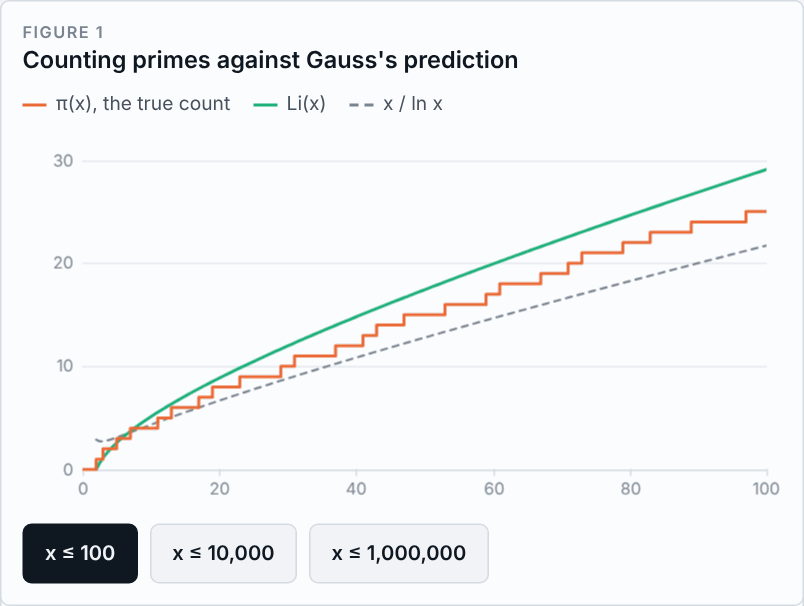
  </picture>
</p>

**Figure 1. Counting primes against Gauss's prediction.** Up close the count is a staircase with irregular steps. From far away it hugs a smooth curve.

> **Worked example.** At $x = 10^6$ there are 78,498 primes and $\mathrm{Li}(x) \approx 78{,}627$. The miss is 129, while $\sqrt{x} = 1{,}000$. If the hypothesis holds, $\lvert \pi(x) - \mathrm{li}(x) \rvert \lt \sqrt{x} \cdot \ln x / 8\pi$ for every $x \ge 2{,}657$ (Schoenfeld, 1976).

### <a id="s2"></a>2. Euler's product

For $s \gt 1$ Euler found that a sum over all integers equals a product over all primes:

```math
\zeta(s) = \sum_{n \ge 1} \frac{1}{n^s} = \prod_{p} \frac{1}{1 - p^{-s}}
```

Expand each factor as a geometric series $1 + p^{-s} + p^{-2s} + \cdots$ and multiply out. Every $n$ appears exactly once, because every integer factors into primes in exactly one way. The product is unique factorisation written as analysis.

<p align="center">
  <picture>
    <source media="(prefers-color-scheme: dark)" srcset="media/figure-02-euler-product-dark.gif">
    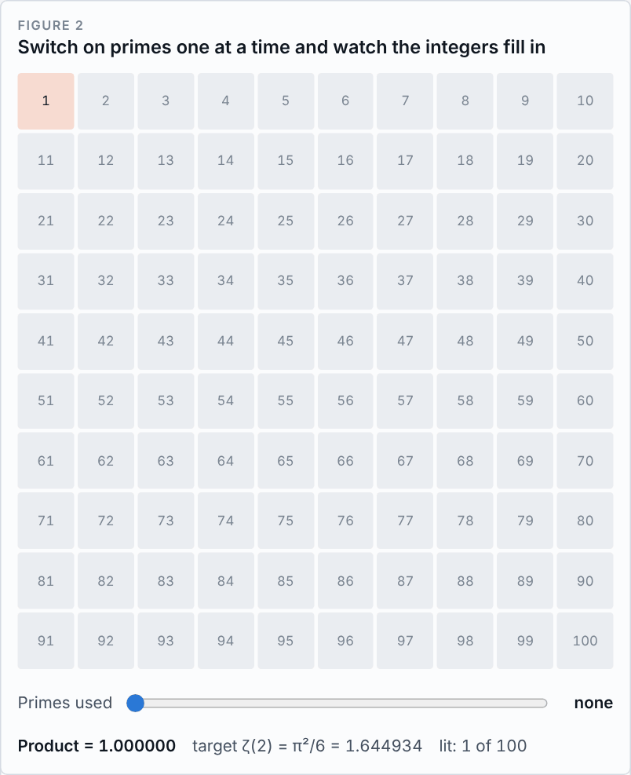
  </picture>
</p>

**Figure 2. Switch on primes one at a time and watch the integers fill in.** Lit cells are the numbers you can build from the primes switched on so far; the newest prime's contribution is solid. The product over those primes equals the sum of $1/n^2$ over every lit number, including those beyond 100.

Two consequences. A convergent product of non-zero factors is non-zero, so $\zeta$ has no zeros with $\operatorname{Re} s \gt 1$. Everything interesting happens further left, where the product stops converging.

### <a id="s3"></a>3. ζ on the complex plane

Riemann's move was to let $s = \sigma + it$ be complex. Each term becomes an arrow:

```math
n^{-s} = n^{-\sigma} \cdot e^{-it \ln n}
```

Its length is $n^{-\sigma}$ and its angle is $-t \ln n$, so as $t$ grows the arrows spin at different speeds. Analytic continuation extends $\zeta$ to every $s \ne 1$, and $\zeta(s)$ is where the arrows end up. A zero is a value of $s$ at which they cancel exactly.

The continued function has a mirror symmetry. With $\xi(s) = \tfrac12 s(s - 1) \pi^{-s/2} \Gamma(s/2) \zeta(s)$, one has $\xi(s) = \xi(1 - s)$, so zeros are symmetric about the line $\sigma = \tfrac12$. There are easy zeros at $-2, -4, -6, \ldots$ All the others lie in the strip $0 \lt \sigma \lt 1$.

> **Riemann hypothesis.** Every zero of $\zeta$ in the strip $0 \lt \sigma \lt 1$ has $\sigma = \tfrac12$.

<p align="center">
  <picture>
    <source media="(prefers-color-scheme: dark)" srcset="media/figure-03-zeta-walk-dark.gif">
    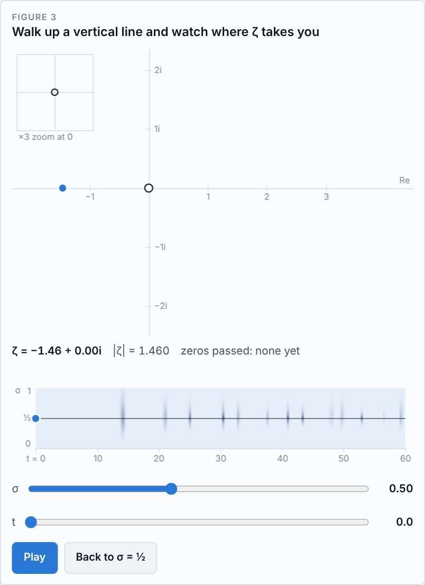
  </picture>
</p>

**Figure 3. Walk up a vertical line and watch where $\zeta$ takes you.** Top: the point $\zeta(\sigma + it)$ as $t$ increases, with a magnified view of the origin in the corner. Bottom: a map of the strip. Each streak marks a place where $\lvert \zeta \rvert$ drops to 0, and every one is centred on $\sigma = \tfrac12$. The line shows the $\sigma$ you are walking along. At $\sigma = \tfrac12$ the path keeps returning to 0. Move $\sigma$ and it misses every time.

Before this month the evidence was large and incomplete. Hardy proved in 1914 that infinitely many zeros lie on the line. Computers have confirmed the hypothesis for every zero up to height $3 \times 10^{12}$. Conrey showed in 1989 that more than 40% of zeros are on the line, and in August 2026 a Lean-checked result by Alpöge and Ralph Furman at Anthropic raised that to more than 67%.

### <a id="s4"></a>4. Zeros are the frequencies of the primes

Count primes with weights: let $\psi(x)$ be the sum of $\ln p$ over all prime powers $p^k \le x$. The prime number theorem says $\psi(x) \approx x$. Riemann's explicit formula, proved by von Mangoldt, is exact:

```math
\psi(x) = x - \sum_{\rho} \frac{x^{\rho}}{\rho} - \ln 2\pi - \tfrac12 \ln\left(1 - x^{-2}\right)
```

The sum runs over the zeros $\rho$ in the strip. Pair a zero $\rho = \beta + i\gamma$ with its conjugate and together they contribute one wave:

```math
-\frac{2x^{\beta}}{\lvert \rho \rvert} \cos(\gamma \ln x - \arg \rho)
```

The height $\gamma$ of the zero is the pitch of the wave. Its real part $\beta$ sets the loudness, which grows like $x^\beta$.

<p align="center">
  <picture>
    <source media="(prefers-color-scheme: dark)" srcset="media/figure-04-explicit-formula-dark.gif">
    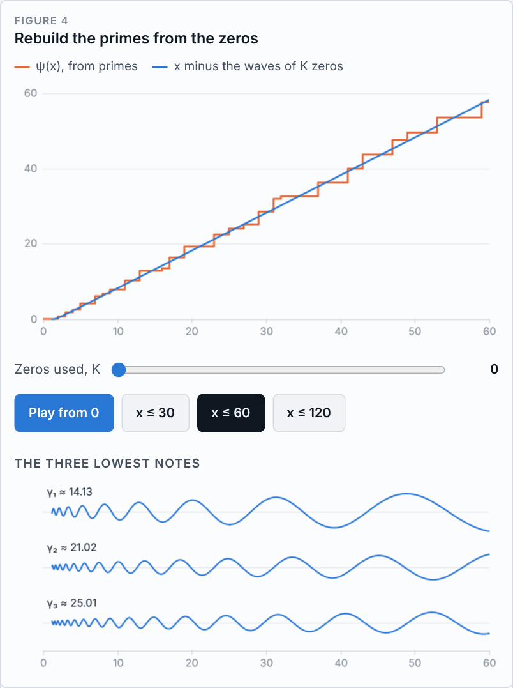
  </picture>
</p>

**Figure 4. Rebuild the primes from the zeros.** Slide $K$ up and the smooth curve learns where every prime power sits. With no zeros it is a straight line. Each added zero is one more wave like the three shown, with higher pitch and lower volume.

> **Worked example.** The prime powers up to 10 are 2, 3, 4, 5, 7, 8, 9, so $\psi(10) = 3 \ln 2 + 2 \ln 3 + \ln 5 + \ln 7 = \ln 2520 \approx 7.83$. The number 2520 is the least common multiple of 1, …, 10. In general $\psi(n) = \ln \mathrm{lcm}(1, \ldots, n)$.

### <a id="s5"></a>5. Why ½: the square-root law

A zero with real part $\beta$ produces an error of size $x^\beta$. Zeros come in mirror pairs $\beta$ and $1 - \beta$, so the best one can hope for is that every $\beta$ equals $\tfrac12$. Then every wave has amplitude $\sqrt{x}$, and

```math
\psi(x) = x + O\left(\sqrt{x} \, \ln^2 x\right)
```

This statement is equivalent to the hypothesis. It is the fluctuation you get from coin flips: the running total of $N$ fair $\pm 1$ tosses wanders about $\sqrt{N}$ from zero. In those terms the hypothesis says the primes are as regular as a random-looking sequence can be. The same claim in olympiad dress: the Möbius sum $\mu(1) + \cdots + \mu(x)$ is $O(x^{1/2 + \varepsilon})$.

<p align="center">
  <picture>
    <source media="(prefers-color-scheme: dark)" srcset="media/figure-05-square-root-error-dark.gif">
    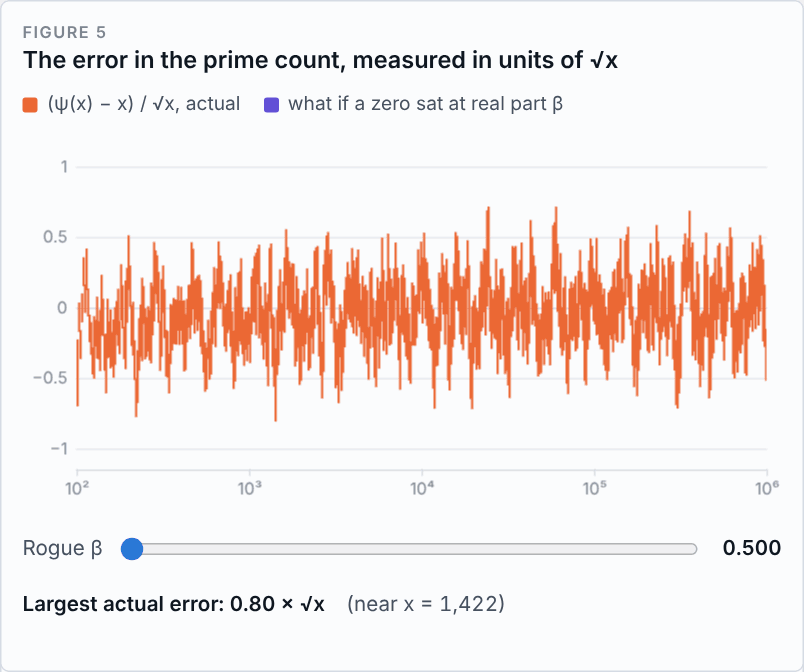
  </picture>
</p>

**Figure 5. The error in the prime count, measured in units of $\sqrt{x}$.** Between $10^2$ and $10^6$ the real error never leaves the band from −0.80 to +0.71. Drag $\beta$ above $\tfrac12$ to see a cartoon of a world where the first pair of zeros sits off the line: one wave grows without limit and swamps everything. (A true off-line zero would also bring a mirror twin at $1 - \beta$.)

### <a id="s6"></a>6. The zeros look like a spectrum

Rescale the gaps between consecutive zeros so that the average gap is 1. They do not look like gaps between randomly scattered points. They look like gaps between eigenvalues of large random Hermitian matrices: the zeros repel one another. Montgomery found this in 1973 and Odlyzko's computations confirmed it to high accuracy.

<p align="center">
  <picture>
    <source media="(prefers-color-scheme: dark)" srcset="media/figure-06-zero-gaps-dark.png">
    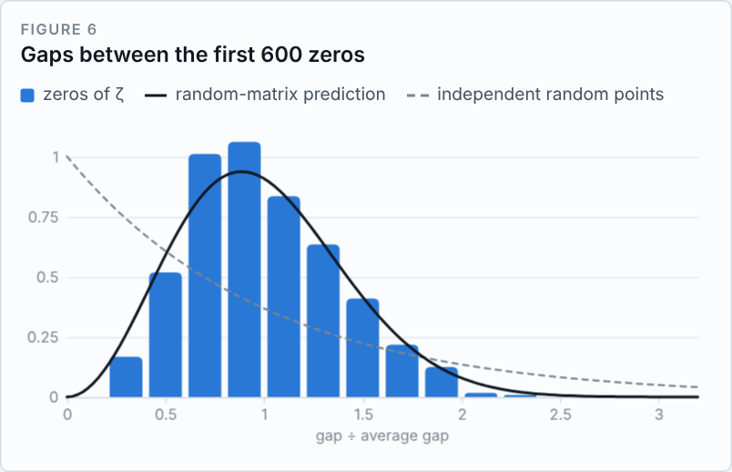
  </picture>
</p>

**Figure 6. Gaps between the first 600 zeros.** Independent points would often sit almost on top of each other. Zeros almost never do.

This is the best evidence for an old idea of Hilbert and Pólya: the heights $\gamma$ are the eigenvalues of some self-adjoint operator. Such eigenvalues are real, which would be the hypothesis. Connes's trace-formula programme follows this route, and so does the Masullo manuscript. The announced proof takes a different road, and to see it we have to visit a parallel world.

## Part II · A world where it is a theorem

### <a id="s7"></a>7. Curves over finite fields

Replace the integers by polynomials over the finite field $\mathbf F_p$, and number fields by curves. A curve $C$ of genus $g$ has a zeta function built from its point counts $`N_k = \#C(\mathbf F_{p^k})`$:

```math
Z(T) = \exp\left(\sum_{k \ge 1} N_k \frac{T^k}{k}\right) = \frac{P(T)}{(1 - T)(1 - pT)}
```

Here $`P(T) = (1 - \alpha_1 T) \cdots (1 - \alpha_{2g} T)`$ is a polynomial of degree $2g$. The Riemann hypothesis for $C$ says $\lvert \alpha_i \rvert = \sqrt{p}$. Substitute $T = p^{-s}$ and this reads: all zeros have $\operatorname{Re} s = \tfrac12$. The critical line has become a circle. Hasse proved it for elliptic curves in 1933 and Weil for all curves in the 1940s. Its practical meaning is a square-root error once more:

```math
\lvert N_1 - (p + 1) \rvert \le 2g\sqrt{p}
```

<p align="center">
  <picture>
    <source media="(prefers-color-scheme: dark)" srcset="media/figure-07-08-elliptic-curve-dark.gif">
    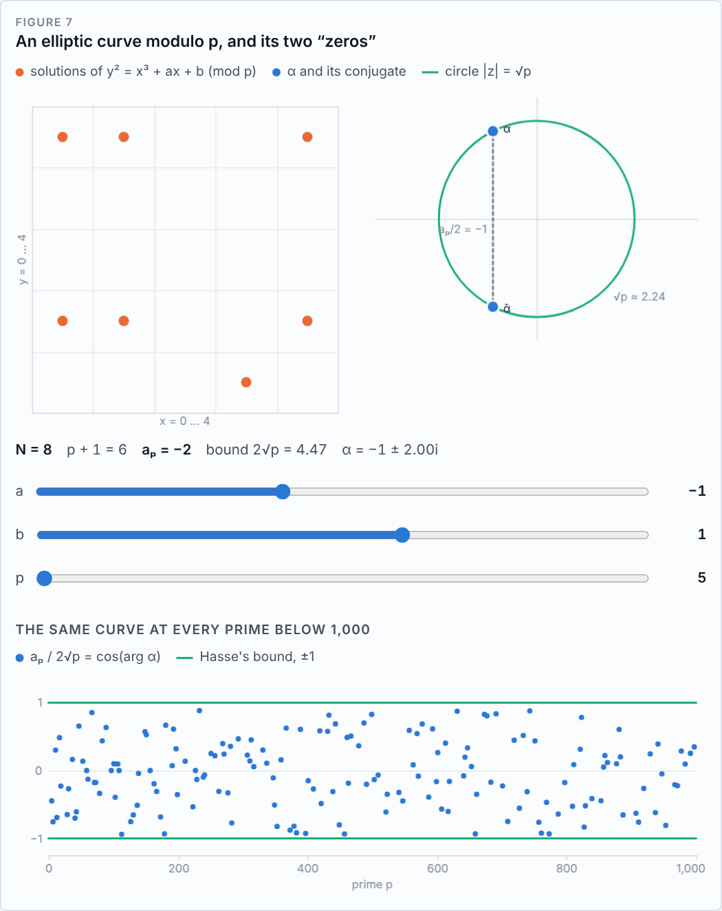
  </picture>
</p>

**Figure 7. An elliptic curve modulo $p$, and its two “zeros”.** **Figure 8** is the lower chart. Count the solutions, add one point at infinity to get $N$, and set $a_p = p + 1 - N$. The numbers $\alpha$ and $\bar\alpha$ with sum $a_p$ and product $p$ always land on the green circle. That is the Riemann hypothesis for this curve, and you can check it by counting.

> **Worked example.** Take $y^2 = x^3 - x$ over $\mathbf F_5$. The solutions are (0, 0), (1, 0), (4, 0), (2, ±1), (3, ±2). With the point at infinity, $N = 8$, so $a_5 = 6 - 8 = -2$ and $\alpha = -1 \pm 2i$. Indeed $\lvert \alpha \rvert^2 = 5$.

### <a id="s8"></a>8. Stepanov's trick: make zeros expensive

Weil's proof needs the geometry of the surface $C \times C$. In 1969 Stepanov found an elementary proof for a large class of curves, which Schmidt and Bombieri extended to all of them. It rests on a fact every olympiad student knows:

> **Degree bound.** A non-zero polynomial of degree $D$ has at most $D$ roots, counted with multiplicity.

To bound the number $N$ of points, build a non-zero auxiliary polynomial that vanishes to order at least $m$ at every one of them, while keeping its degree $D$ under control. Then $N \cdot m \le D$, so $N \le D/m$.

<p align="center">
  <picture>
    <source media="(prefers-color-scheme: dark)" srcset="media/figure-09-multiplicity-dark.gif">
    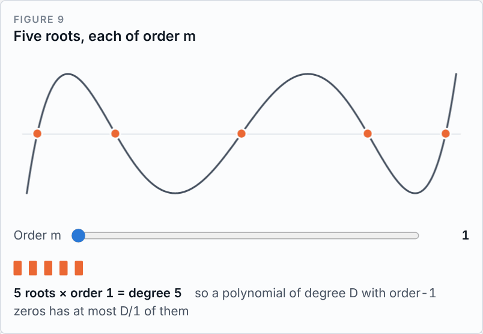
  </picture>
</p>

**Figure 9. Five roots, each of order $m$.** Higher order means flatter contact with the axis. Each unit of order at each root uses up one unit of degree, shown as one block.

The auxiliary polynomial is never written down. Its existence comes from linear algebra: arrange for more free coefficients than vanishing conditions. High-order vanishing is tested with derivatives, and in characteristic $p$ derivatives are generous, since $(x^p)' = 0$.

The result has the shape $N \le \text{main term} + C \cdot (p/m + m)$, and the best choice is $m \approx \sqrt{p}$. That is where the square root comes from. Only an upper bound comes out, and that is enough: for $y^2 = f(x)$ the same argument bounds the $x$ where $f(x)$ is a non-square, the two counts add up to about $p$, and so an upper bound for each is a lower bound for the other.

### <a id="s9"></a>9. The missing ingredient over the integers

Number theorists keep a dictionary between polynomials over $\mathbf F_p$ and integers.

| Polynomials $\mathbf F_p[t]$ | Integers $\mathbf Z$ |
|:--|:--|
| a polynomial $f$ | an integer $n$ |
| a point $a$ (the factor $t - a$) | a prime $p$ |
| $f$ vanishes to order $m$ at $a$ | $p^m$ divides $n$ |
| the degree of $f$ | the size $\ln \lvert n \rvert$ |
| roots with multiplicity ≤ degree | $\sum_p v_p(n) \ln p = \ln \lvert n \rvert$ |

The last row is unique factorisation again: an integer cannot be divisible by more than its size allows. Chebyshev's bounds on primes around 1850 run on exactly this, and the version with a binomial coefficient is an olympiad classic. The number $C(2n, n)$ is an integer smaller than $4^n$, and every prime between $n$ and $2n$ divides it. Hence

```math
\sum_{n < p \le 2n} \ln p \;\le\; \ln C(2n, n) \;<\; 2n \ln 2
```

an upper bound for a sum over primes, obtained from divisibility on one side and size on the other.

<p align="center">
  <picture>
    <source media="(prefers-color-scheme: dark)" srcset="media/figure-10-binomial-dark.gif">
    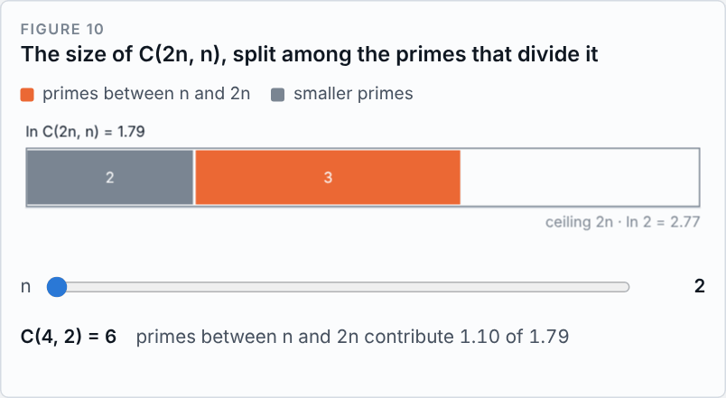
  </picture>
</p>

**Figure 10. The size of $C(2n, n)$, split among the primes that divide it.** The whole bar has length $\ln C(2n, n)$. Each segment is one prime's share, $v_p \cdot \ln p$. The outline behind it is the ceiling $2n \cdot \ln 2$. This example is an illustration of the principle chosen for this page. It is not a step of the announced proof.

Chebyshev's bound is off by a constant factor. To reach the Riemann hypothesis the error has to come down to $\sqrt{x}$, and Stepanov's recipe then asks for vanishing of order $m \approx \sqrt{x}$. Over $\mathbf F_p[t]$ you get high order by differentiating. An integer has no derivative. For half a century that was where the transfer stopped.

## Part III · The announced proof

### <a id="s10"></a>10. Multiplicity from a chain of theta lifts

> [!IMPORTANT]
> **Reported, not yet digested.** This section is assembled from Alpöge's four-page note and from a reading guide by early readers of the Lean code, who state that the central steps are read off the code and the announcement and have not been re-derived. Expect corrections.

The note describes the argument as a descendant of Stepanov's, in which each theta lift mimics one unit of multiplicity. The guide gives this dictionary:

| Stepanov, curves over $\mathbf F_p$ | Announced proof, over $\mathbf Z$ |
|:--|:--|
| vanishing to order $m$ | divisibility of an $m$-fold iterated theta lift |
| counting degrees | Bost's slope inequality |
| the finite extensions of $\mathbf F_p$ | the layers of a cyclotomic tower of fields |
| upper bounds suffice | a theorem of Landau type |

**What is a theta lift?** A theta function such as $\vartheta(z) = \sum e^{\pi i n^2 z}$ packages a lattice into a highly symmetric function. The theta correspondence uses such a function as a kernel that carries automorphic forms from one group to a partner group. The groups here are unitary groups $\mathrm U(X_j)$ of positive-definite Hermitian spaces. On those, an automorphic form is just a function on a finite set of lattice classes, so a lift is a finite matrix with arithmetic entries, and the output of one lift can be fed into the next.

**Why would that create multiplicity?** The guide's model case is an elliptic curve with complex multiplication by $\mathbf Q(\sqrt{-d})$, with theta function $\vartheta$ and period $\Omega$. The normalised derivatives $D^a \vartheta(0) / \Omega^a$ are divisible by $p$ to the power $a/p + a/p^2 + \cdots - O(\log a)$ at every prime $p$ that stays prime in that field. That exponent is Legendre's formula for the power of $p$ in $a!$. Differentiating a theta function manufactures factorial-sized divisibility at many primes at once. The chain replaces “differentiate $m$ times” by “lift $m$ times”.

<p align="center">
  <picture>
    <source media="(prefers-color-scheme: dark)" srcset="media/figure-11-theta-chain-dark.gif">
    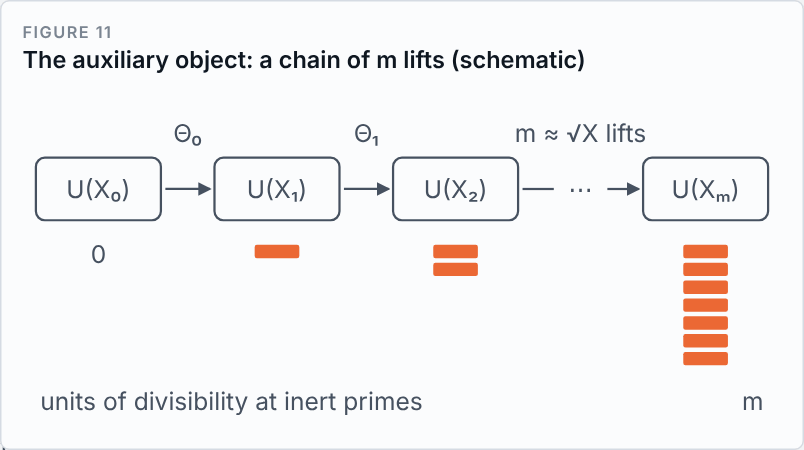
  </picture>
</p>

**Figure 11. The auxiliary object: a chain of $m$ lifts (schematic).** Each lift is reported to add one unit of divisibility, the way each derivative adds one unit of vanishing in Stepanov's proof. The drawing shows the bookkeeping only. The lifts themselves live in the theory of automorphic forms on higher-rank groups.

Put together, the guide's outline runs like this.

1. **Target.** A smoothed sum over prime powers, $`G(x) = \sum_{n \le x} \Lambda(n)(x/n - 1) - x(\ln x - 1 - \gamma)`$, and its twists by Dirichlet characters. By the explicit formula it is a sum of waves $x^\beta$ over zeros. Goal: $G(x) \le x^{1/2 + \varepsilon}$ on windows $[Y, Y^{3/2}]$ for arbitrarily large $Y$.
2. **Auxiliary object.** The composite $`\Theta = \Theta_{m-1} \circ \cdots \circ \Theta_0`$ of theta lifts, each twisted by a Hecke character. It plays the part of Stepanov's polynomial.
3. **Finite primes.** $\Theta$ is integral, and at inert primes it is more divisible than integrality alone would give. The total gain is a weighted sum of $\ln p$, which is a sum over primes.
4. **The infinite place.** The size of $\Theta$ is computed with classical exact formulas: Chowla and Selberg's for the period $\Omega$, Siegel's mass formula, and the Rallis inner product formula.
5. **Slope inequality.** Bost's inequality is the arithmetic form of the degree bound: divisibility at the finite primes has to be paid for by size at infinity. Out comes an upper bound for the prime sum with error about $x/m + m + \sqrt{x}$.
6. **Landau.** A one-sided bound this strong leaves no room for a zero with real part above $\tfrac12$. Figure 5 shows why: its wave would swing up through the ceiling. The functional equation reflects the left half of the strip onto the right, so every zero is on the line. Running the argument for each Dirichlet character gives the generalised hypothesis for Dirichlet $L$-functions.

<p align="center">
  <picture>
    <source media="(prefers-color-scheme: dark)" srcset="media/figure-12-chain-length-dark.gif">
    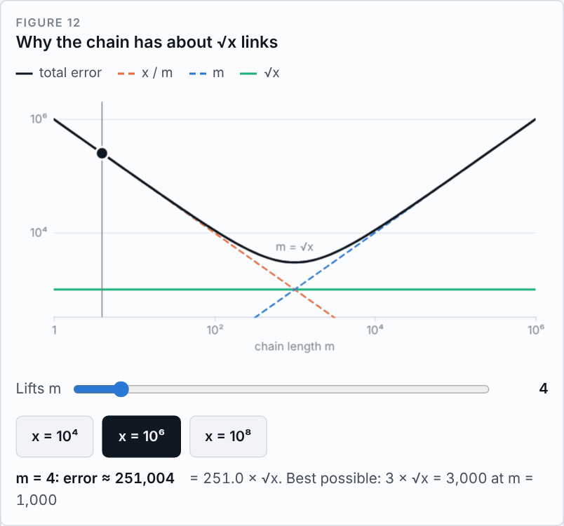
  </picture>
</p>

**Figure 12. Why the chain has about $\sqrt{x}$ links.** The reported error is about $x/m + m + \sqrt{x}$, up to factors $x^{O(\varepsilon)}$ left out here. Too few lifts waste the available divisibility. Too many cost more than they earn. The balance point is $m \approx \sqrt{x}$, the same balance as in Stepanov's proof.

**Who did what.** By Alpöge's account he had aimed at this problem since his student days and steered the work toward a setting modelled on a simpler toy problem. He credits Claude with proposing the chain of lifts and with outpacing him near the end. The note's research timeline, from 6 October to 16 November, was compiled by Claude, and he warns that it is rough. The note does not say which Claude model was used.

### <a id="s11"></a>11. What a machine check settles

Lean's kernel checks one thing: that a proof term has the type it claims. Here the type is Mathlib's `RiemannHypothesis`, a definition written by other people years earlier. Two comparison tools confirmed that the release proves that exact statement. Independent kernels re-checked the full proof, and an axiom audit found only `propext`, `Classical.choice` and `Quot.sound`. That settles whether the formal statement follows from the axioms, as far as the checkers themselves can be trusted.

It leaves two things open. One is whether every definition underneath says what mathematicians mean by it; Mathlib's statement is short and widely used, which helps. The other is the why. A proof nobody can read cannot be taught, shortened or extended. Terence Tao's first reading is that the argument combines recent results from the Langlands programme and arithmetic geometry and will take time to absorb. James Maynard told *Nature* he suspects it will turn out to be correct. Alpöge expects much shorter proofs to follow.

- **6 Oct.** First key step in the note's timeline: a “Stepanov determinant”.
- **20 Oct.** The argument commits to a weighted sum over primes.
- **15 Nov.** Iterated theta lifts supply the missing multiplicity.
- **16 Nov.** The argument reaches the generalised hypothesis.
- **20 Nov.** Note and Lean archive posted. Andrew Sutherland at MIT reports an independent build of all 175,187 modules with no errors. Vakil releases Masullo's manuscript.
- **21 Nov.** Joint statement from the Lean and Mathlib communities, endorsed by the Lean FRO and the Mathlib Initiative, certifying statement and proof.
- **22 Nov.** A sandboxed rebuild reproduces the published proof export byte for byte. Auditors continue to log open questions about trivial internal definitions.

The October and mid-November dates come from the note itself and have not been checked independently. The Clay Institute's rules for the million-dollar prize require publication, a two-year wait and general acceptance.

### <a id="s12"></a>12. If it stands

Decades of theorems begin with the words “assume GRH”. For Dirichlet $L$-functions they would lose that clause.

- Prime counting with square-root error: $\lvert \pi(x) - \mathrm{li}(x) \rvert \lt \sqrt{x} \ln x / 8\pi$ for $x \ge 2{,}657$.
- Primes spread just as evenly among the residue classes of any modulus.
- Miller's primality test becomes a proven deterministic algorithm: checking bases up to $2 \ln^2 n$ is enough (Bach).

The method may matter more than the statement. If the chain of lifts really does the work of a derivative of an integer, it is a new tool, and the obvious next targets are the $L$-functions the announcement does not cover.

## Sources

- [Levent Alpöge's website](https://alpo.ge), where the note “Remark” and the Lean archive were posted
- [A guide to the architecture of the announced proof](https://nasqret.github.io/riemann-rev/guide/proof-guide.pdf) (independent reading project)
- [lean4.dev: the claimed proof, delivered in Lean](https://lean4.dev/proofs/riemann-hypothesis-claim)
- [Coverage of the Lean FRO and Mathlib Initiative joint statement](https://officechai.com/ai/lean-community-certifies-levent-alpoges-claude-assisted-proof-of-the-riemann-hypothesis-as-correct/)
- [Verification log summary, including Sutherland's build](https://kingy.ai/blog/levent-alpoge-claude-riemann-hypothesis-proof/)
- [Nature](https://www.nature.com/articles/d41586-026-03812-7) and [Science](https://www.science.org/content/article/ai-may-have-solved-math-s-greatest-mystery-can-humans-understand-answer) news reports
- [Open question 10: a degenerate geometric instance](https://github.com/aapolipponen/rh-lean-check-lumi/issues/2), and the [unreviewed paper](https://philpapers.org/rec/NIEIOT-2) arguing invalidity
- [John Baez on Masullo's manuscript](https://johncarlosbaez.wordpress.com/2026/11/22/masullo-on-the-riemann-hypothesis/)
- [Independent status tracker](https://riemannhypothesisclaude.org/)

Every chart in the interactive version is computed in your browser: primes by sieve to $10^6$, $\zeta$ by Borwein's algorithm, point counts by brute force. The first 600 zeros were computed beforehand with mpmath. Built by Claude on 22 November 2026.

## The videos

The two videos at the top of this page are 1920×1080, with spoken narration and burnt-in captions. They share their opening and closing scenes; the extended cut replaces one scene in the middle with five.

<p align="center">
  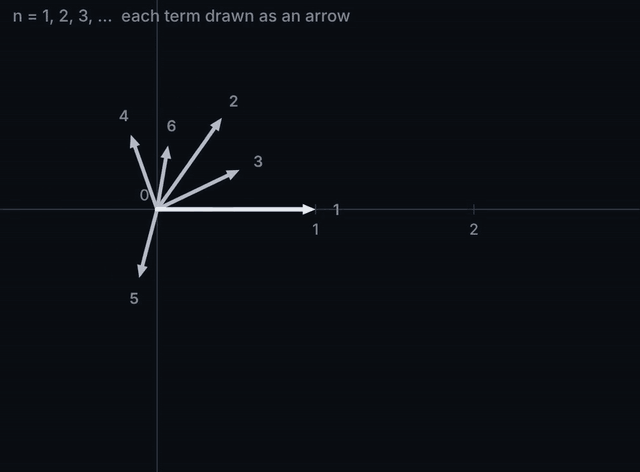
</p>

**From the extended cut.** Each term $n^{-s}$ is an arrow of length $n^{-1/2}$ turned through the angle $-t \ln n$. Laid head to tail, the first few make big strides and the rest spiral around one point. That point is $\zeta(\tfrac12 + it)$. On this line the sum itself does not converge: the spiral keeps widening as terms are added, and analytic continuation picks out its centre.

Captions, transcripts, scene lists and build notes are in [`video/`](video).

## About this repository

| Path | What it is |
|:--|:--|
| `README.md` | This post. |
| [`index.html`](index.html) | The interactive version, served at https://den-run-ai.github.io/riemann/: twelve live figures, with both videos at the top. The figures need no other file; the two players load the files in `video/`. |
| [`video/`](video) | The two finished videos, with captions (`.srt`) and narration transcripts. |
| [`media/`](media) | The recordings and stills shown on this page, and the poster frames of the two video players. |
| [`src/explainer/`](src/explainer) | Source of `index.html`: markup and figure code, number-theory helpers, the first 600 zeros of zeta, build script. |
| [`src/video/`](src/video) | Source of the videos: scene renderer, build scripts, and for each cut its narration script, recorded narration and timeline. |
| [`src/readme/`](src/readme) | The scripts that record the figures for this page and put the play button on the video stills, and checks for the page itself. |
| [`docs/SESSION.md`](docs/SESSION.md) | Log of the sessions that produced all of this: prompts, what was checked, what could not be. |

### Read this first

- **It is a snapshot.** The status described is that of 22 November 2026, two days after the announcement. A last search that evening still found no reversal: the [joint statement of the Lean and Mathlib communities](https://leanprover-community.github.io/blog/posts/riemann-hypothesis/) stood, and human review of the argument had only begun. Nothing later is reflected here.
- **Sections 1 to 9 are established mathematics. Sections 10 and 11 are secondhand.** They describe the announced proof from summaries of Alpöge's four-page note and from a reading guide by early readers of the Lean code. The note itself and the *Nature* and *Science* reports could not be opened while this was written.
- **The author is an AI model.** The text, code, figures and videos were written by Claude, and the result being described is credited in part to Claude. Treat the account of the proof as a careful summary of public reporting, not as inside knowledge.
- **The narration is a synthetic voice** (Kokoro). Its timing was checked numerically; nobody listened to it before delivery. The name Alpöge is approximated in the audio and spelled correctly in the captions.
- **One illustration is this post's own.** Figure 10 (Chebyshev's binomial coefficient) was chosen to show the principle “divisibility is paid for by size”. It is not a step of the announced proof.

### Rebuilding

```sh
# the interactive page
python3 src/explainer/build.py        # rewrites index.html from src.html, lib.js and zeros.json
node src/explainer/check.js           # numeric spot checks of the helpers

# the recordings on this page (needs: pip install playwright, a Chrome or Chromium, ffmpeg)
python3 src/readme/record.py          # every figure, light and dark, into media/
python3 src/readme/check.py           # the formulas and links of this README (pip install cmarkgfm)

# the videos (needs the above plus npm, for the fonts)
src/video/make_video.sh short         # 3-minute cut, from the shipped narration
src/video/make_video.sh extended      # 5-minute cut
```

Set `CHROME=/path/to/chrome` to choose the browser. [`video/README.md`](video/README.md) explains how to change the narration and re-record it.

### Credits

- Prompts and direction: the repository owner. Writing, code, figures and videos: Claude (Anthropic).
- Voice: [Kokoro](https://github.com/thewh1teagle/kokoro-onnx) text-to-speech (Apache-2.0 model), voice `af_heart`.
- Typefaces: Bodoni Moda, STIX Two and Inter, all under the SIL Open Font License. None are stored in this repository.
- Zeros of zeta: computed with [mpmath](https://mpmath.org).

### License

[MIT](LICENSE).
